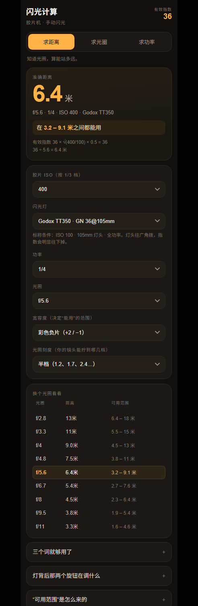

# 闪光计算 · 胶片机手动闪光

一个单文件网页工具：指数、光圈、距离、功率，**填二补一**。

手机上打开、加到主屏幕就是一个 App，断网也能用。不联网、不上传、没有账号。

## 三种问法

| 你手上有的 | 工具给你 |
|---|---|
| 光圈 + ISO | 距离：站几米内能曝对 |
| 距离 + ISO | 光圈：该开多大 |
| 光圈 + 距离 | 功率：灯该调到哪一档 |

## 它和别的曝光计算器不一样的地方

- **给的是区间，不是一个点。** 负片按 +2/−1 档算，f/5.6 下准确距离 6.4 米，工具会说「3.2 – 9.1 米之间都能用」。这才是现场敢用的东西。
- **ISO 按 1/3 档。** 选 160 会直接告诉你「相当于把 200 的卷过曝 1/3 档」——不用再叠一层曝光补偿。
- **功率按灯上的写法给。** `1/16 −0.3`、`1/2 −0.7`，跟你闪光灯 LCD 上的显示一致。
- **内置型号标出标称灯头焦距。** `GN 36@105mm` 和 `GN 38@35mm` 不是一回事，混在一起比会得出错误结论。

## 数据从哪来

闪光指数取厂商标称值：ISO 100、全功率、厂商指定的灯头焦距。数学部分全部由公式算出，没有经验值：

```
GN有效 = GN标称 × √(ISO/100) × √(功率)
距离 = GN有效 ÷ 光圈
```

灯头变焦到广角时指数会下降，但厂商很少给全各焦段数值，所以本工具不做估算——你可以用「自定义指数」填你实测的值。

## 部署

纯静态，无构建。仓库根目录放 `index.html` 和 `sw.js`，GitHub Pages 选 `main` / root 即可。`sw.js` 只做离线缓存。

## 测试

```bash
node test/core.test.mjs
```

24 项，覆盖指数换算、宽容带两端、三种模式互相闭合、就近取档、功率档位标签。


